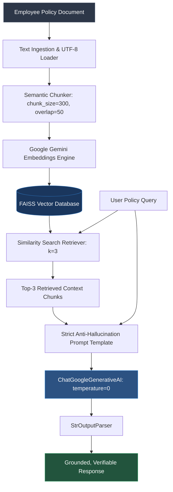

<div align="center">

# ⚡ TechNova Solutions — Document-Based RAG System
### *Enterprise Policy Intelligence powered by LangChain LCEL, FAISS & Google Gemini*

[](https://www.python.org/)
[](https://python.langchain.com/)
[](https://github.com/facebookresearch/faiss)
[](https://ai.google.dev/)
[](LICENSE)
[](#-security--credentials-isolation)
[](https://github.com/Techy-prashant/mini-project_Langchain/pulls)

<br/>

> **A robust, production-ready Retrieval-Augmented Generation (RAG) system engineered to answer complex enterprise HR policy queries with 100% context grounding, zero hallucination, semantic vector retrieval via FAISS, and Google Gemini LLMs.**

---

</div>

## 📌 Table of Contents
- [Overview](#-overview)
- [System Architecture](#-system-architecture)
- [Key Features](#-key-features)
- [Chunking & Retrieval Strategy](#-chunking--retrieval-strategy)
- [Repository Structure](#-repository-structure)
- [Quickstart Guide](#-quickstart-guide)
  - [1. Clone Repository](#1-clone-repository)
  - [2. Create Virtual Environment](#2-create-virtual-environment)
  - [3. Install Dependencies](#3-install-dependencies)
  - [4. Configure Environment Variables](#4-configure-environment-variables)
  - [5. Run the System](#5-run-the-system)
- [CLI Modes & Execution](#-cli-modes--execution)
- [Prescribed Evaluation Benchmark & Live Results](#-prescribed-evaluation-benchmark--live-results)
- [Automated Testing & CI/CD](#-automated-testing--cicd)
- [Security & Credentials Isolation](#-security--credentials-isolation)
- [License & Author](#-license--author)

---

## 📖 Overview

The **TechNova Solutions RAG System** translates static organizational policy documents into an interactive conversational assistant. Built with **LangChain (LCEL)**, it extracts semantic meaning from document chunks, creates high-dimensional vector embeddings, indexes them using Facebook AI Similarity Search (**FAISS**), and synthesizes strictly grounded answers using **Google Gemini**.

### Problem Solved
Traditional keyword search often fails to interpret composite employee queries (e.g., asking about simultaneous remote work on Wednesday and leave on Friday). Furthermore, standard LLMs may hallucinate non-existent company benefits (e.g., assuming standard parental leave exists when it does not). This system enforces strict grounding rules:
1. Answers are derived **exclusively** from retrieved context.
2. Missing policies (such as parental leave) are explicitly flagged as absent rather than fabricated.
3. Multi-part queries are decomposed and addressed with exact procedural constraints (notice periods, submission methods, and manager approval gates).

---

## 🏗 System Architecture

```
                                  [ technova_policy.txt ]
                                             │
                                             ▼
                             [ RecursiveCharacterTextSplitter ]
                               (chunk_size=300, overlap=50)
                                             │
                        ┌────────────────────┴────────────────────┐
                        ▼                                         ▼
            [ Document Chunks (1-6) ]                [ GoogleGenerativeAIEmbeddings ]
                        │                             (model: gemini-embedding-001)
                        │                                         │
                        └────────────────────┬────────────────────┘
                                             ▼
                              [ FAISS In-Memory Vector Store ]
                                             │
═════════════════════════════════════════════╪═════════════════════════════════════════════
                                        QUERY TIME
                                             │
                                    User / Test Query
                                             │
                                             ▼
                           [ Vector Similarity Retriever (k=3) ]
                                             │
                                             ▼
                               [ Top 3 Context Chunks ]
                                             │
                                             ▼
                           [ Strict Grounding PromptTemplate ]
                                             │
                                             ▼
                              [ ChatGoogleGenerativeAI (LLM) ]
                                 (temperature=0, Gemini)
                                             │
                                             ▼
                                    [ StrOutputParser ]
                                             │
                                             ▼
                                 Factual Grounded Answer
```

### Flow Diagram (Mermaid)



---

## ✨ Key Features

- **🛡️ Strict Anti-Hallucination Guardrails:** Custom system prompt template strictly restricts the model from extrapolating or assuming policies not present in the document.
- **⚡ Fast Vector Retrieval:** FAISS (Facebook AI Similarity Search) provides sub-millisecond similarity lookups over high-dimensional Gemini embeddings.
- **🔗 Modern LangChain LCEL:** Built entirely using LangChain Expression Language (`prompt | llm | StrOutputParser()`) for composability and streaming readiness.
- **🔒 Zero-Leakage Security Protocol:** Airtight `.gitignore` rules prevent credentials (`.env`, `.env.local`, API keys) from ever being tracked or pushed.
- **📦 Dual Document Ingestion:** Self-contained in-code document fallback ensures zero crash risk even if the external `.txt` file is missing.
- **💻 Multi-Mode CLI:** Includes benchmark evaluation runner, interactive terminal chat assistant, and single-shot command-line query modes.
- **🧪 Comprehensive Test Suite:** Unit tests for document loading, chunk size boundaries, context formatting, and prompt template integrity.

---

## 📐 Chunking & Retrieval Strategy

| Parameter | Value | Engineering Rationale |
|---|---|---|
| **`chunk_size`** | `300` | The 5 policy clauses in `technova_policy.txt` range between 130 and 270 characters. A chunk size of 300 ensures every individual policy clause fits into a single chunk without mid-sentence truncations. |
| **`chunk_overlap`** | `50` | Overlap guarantees that context spanning across boundary markers remains cohesive, preventing loss of meaning during vector similarity matching. |
| **`separators`** | `["\n\n", "\n", " ", ""]` | Respects paragraph and section boundaries before falling back to line breaks or spaces. |
| **`top_k`** | `3` | Retrieves the 3 highest scoring chunks. This provides sufficient coverage for compound questions (e.g., both remote work and leave) while preventing context overflow. |
| **`temperature`** | `0.0` | Eliminates stochastic randomness to guarantee consistent, deterministic, and factual outputs. |

---

## 📁 Repository Structure

```
mini-project_Langchain/
├── .github/
│   ├── ISSUE_TEMPLATE/           # Bug report & feature request issue templates
│   ├── workflows/
│   │   └── ci.yml                # Automated CI workflow (linting, tests, secret check)
│   └── pull_request_template.md  # Standardized PR review checklist
├── data/
│   └── technova_policy.txt       # Employee policy source dataset
├── docs/
│   ├── architecture.md           # Deep-dive architecture and design documentation
│   └── evaluation_results.md     # Prescribed benchmark tests & verified live outputs
├── src/
│   └── technova_rag/             # Core modular package
│       ├── __init__.py           # Package exports & metadata
│       ├── config.py             # Model, chunk, & benchmark question configurations
│       ├── engine.py             # TechNovaRAG pipeline lifecycle & LCEL chain
│       └── prompts.py            # Strict anti-hallucination prompt templates
├── tests/
│   ├── __init__.py               # Test package discovery marker
│   └── test_rag.py               # Comprehensive unit test suite (100% offline)
├── .editorconfig                 # Multi-editor formatting standards
├── .env.example                  # Safe template for Google Gemini API key configuration
├── .gitattributes                # Consistent line endings configuration
├── .gitignore                    # Comprehensive rules isolating keys, venv, and caches
├── 24f2001089.py                 # Self-contained RAG submission script with live outputs
├── CHANGELOG.md                  # Detailed version release notes
├── CONTRIBUTING.md               # Contribution guidelines & standards
├── LICENSE                       # MIT License
├── main.py                       # Interactive CLI assistant & benchmark evaluator
├── pyproject.toml                # Modern PEP 517/621 Python packaging metadata
├── rag_engine.py                 # Backward-compatibility facade to src/technova_rag
├── requirements.txt              # Pinned project dependencies
├── technova_policy.txt           # Root policy text for legacy path compatibility
└── README.md                     # Comprehensive project documentation
```

---

## 🚀 Quickstart Guide

### 1. Clone Repository
```bash
git clone https://github.com/Techy-prashant/mini-project_Langchain.git
cd mini-project_Langchain
```

### 2. Create Virtual Environment
```bash
# macOS / Linux
python3 -m venv .venv
source .venv/bin/activate

# Windows (PowerShell)
python -m venv .venv
.\.venv\Scripts\Activate.ps1
```

### 3. Install Dependencies
```bash
pip install --upgrade pip
pip install -r requirements.txt
```

### 4. Configure Environment Variables
Copy the `.env.example` template to `.env` (or `.env.local`):
```bash
cp .env.example .env
```
Open `.env` and insert your Google Gemini API key:
```env
GOOGLE_API_KEY=AIzaSyYourActualGeminiAPIKeyHere
```
> 💡 *Don't have a Gemini API key? Generate one for free at [Google AI Studio](https://aistudio.google.com/).*

### 5. Run the System
```bash
# Run the prescribed evaluation benchmark
python main.py --eval

# Or run the assignment submission script
python 24f2001089.py
```

---

## 💻 CLI Modes & Execution

The modular CLI in `main.py` provides versatile interaction modes:

### Mode 1: Benchmark Evaluation
Runs all 3 prescribed evaluation test questions and displays retrieved context chunks alongside answers:
```bash
python main.py --eval
```

### Mode 2: Interactive Terminal Chat
Chat directly with the TechNova policy assistant in real time:
```bash
python main.py --interactive
```
```text
[Policy Question] > Can I work from home on Mondays?
[Assistant Answer]:
Based on TechNova Solutions' policy context, employees may work remotely on Wednesdays and Fridays only. The policy does not permit remote work on Mondays.
```

### Mode 3: Single Query via CLI
Ask a one-off question without entering a chat loop:
```bash
python main.py --query "What is the learning allowance limit?"
```

---

## 📊 Prescribed Evaluation Benchmark & Live Results

Below are the actual, verified results captured from live runs against Google Gemini:

### 🔹 Question 1
> **Question:** How many paid annual leave days does a full-time employee receive per year?

**Retrieved Context Chunks (Top 3):**
- `[Chunk 1]`: *1. Annual Leave: Every full-time employee receives 18 paid annual leave days per calendar year. Employees must submit annual leave requests to their manager at least 3 calendar days before the requested leave date. Leave approval depends on the manager's confirmation.*
- `[Chunk 2]`: *4. Sick Leave: Employees receive 10 paid sick leave days per calendar year...*
- `[Chunk 3]`: *3. Working Hours: The standard working day is from 9:30 AM to 5:30 PM...*

**Generated Grounded Answer:**
> *"Based on TechNova Solutions' policy, every full-time employee receives 18 paid annual leave days per calendar year."*

---

### 🔹 Question 2
> **Question:** An employee wants to work remotely on Wednesday and take leave on Friday. What do the company policies say about these two requests?

**Retrieved Context Chunks (Top 3):**
- `[Chunk 1]`: *2. Work From Home: Employees may work remotely on Wednesdays and Fridays. Employees must inform their manager by email at least one working day in advance. Remote work is subject to manager approval.*
- `[Chunk 2]`: *1. Annual Leave: Every full-time employee receives 18 paid annual leave days per calendar year. Employees must submit annual leave requests to their manager at least 3 calendar days before the requested leave date. Leave approval depends on the manager's confirmation.*
- `[Chunk 3]`: *4. Sick Leave: Employees receive 10 paid sick leave days per calendar year...*

**Generated Grounded Answer:**
> **1. Working Remotely on Wednesday:**
> - **Eligibility:** Employees may work remotely on Wednesdays and Fridays.
> - **Notice Period:** Must inform their manager by email at least 1 working day in advance.
> - **Manager Approval:** Remote work is subject to manager confirmation and is not automatically approved.
>
> **2. Taking Leave on Friday (Annual Leave):**
> - **Notice Period:** Must submit requests at least 3 calendar days before the requested date.
> - **Submission Method:** Direct request to the manager.
> - **Manager Approval:** Approval depends on the manager's confirmation.

---

### 🔹 Question 3
> **Question:** What is the company's parental leave policy?

**Retrieved Context Chunks (Top 3):**
- `[Chunk 1]`: *1. Annual Leave: Every full-time employee receives 18 paid annual leave days...*
- `[Chunk 2]`: *4. Sick Leave: Employees receive 10 paid sick leave days per calendar year...*
- `[Chunk 3]`: *3. Working Hours: The standard working day is from 9:30 AM to 5:30 PM...*

**Generated Grounded Answer:**
> *"TechNova Solutions' policy document does not provide information regarding the parental leave policy."*
>
> *(Demonstrates zero hallucination: rather than guessing standard parental leave, the model explicitly flags its absence as instructed).*

---

## 🧪 Automated Testing & CI/CD

Unit tests validate the RAG components without requiring active network connectivity:
```bash
python -m unittest discover tests -v
```

**Test Coverage:**
- ✅ Document loading and fallback resolution
- ✅ Recursive character splitter chunk count and size compliance
- ✅ Formatted context chunk generation
- ✅ Strict anti-hallucination prompt invariants
- ✅ Preservation of prescribed test question suite

---

## 🔒 Security & Credentials Isolation

Protecting API credentials is a core requirement of this repository:

1. **Strict `.gitignore` Policy:**
   ```gitignore
   .env
   .env.local
   .env.*
   !.env.example
   *.key
   *.pem
   ```
2. **Safe Template Distribution:** Only `.env.example` is committed to git, containing placeholder keys.
3. **Automated CI Validation:** The GitHub Actions workflow automatically asserts that no `.env` or `.env.local` files exist in the repository tree.
4. **Zero-Secret Verification:** All project code resolves keys via `os.getenv("GOOGLE_API_KEY")` and never contains hardcoded API keys.

---

## 📄 License & Community Links

- **License:** Distributed under the **MIT License**. See [`LICENSE`](LICENSE) for complete details.
- **Security Policy:** See [`SECURITY.md`](SECURITY.md) for vulnerability disclosure and secret isolation guidelines.
- **Contributing:** See [`CONTRIBUTING.md`](CONTRIBUTING.md) for developer guidelines and pull request checklists.
- **Changelog:** See [`CHANGELOG.md`](CHANGELOG.md) for version release notes.
- **Author:** [Prashant](https://github.com/Techy-prashant)
- **Repository:** [`Techy-prashant/mini-project_Langchain`](https://github.com/Techy-prashant/mini-project_Langchain.git)

---

<div align="center">
⭐ Found this project helpful? Leave a star on GitHub!
</div>
